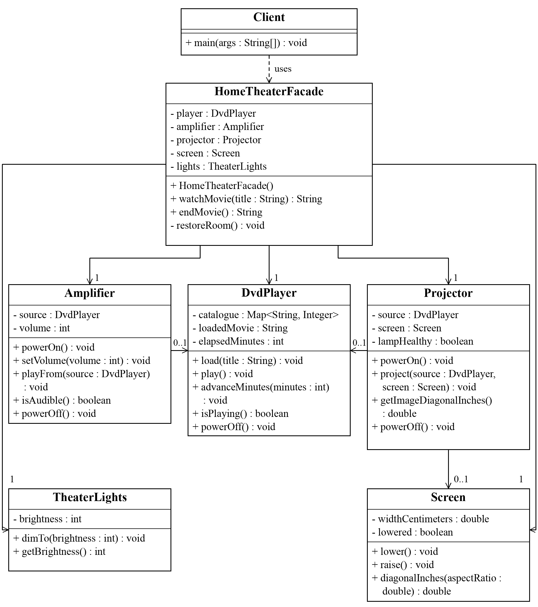

# Home Theater Facade Defense Guide

**Assignment 4**  |  ShP-2216 Software Design Patterns

Ziyadinkhan Kudaibergenuly

Use this guide to explain the working Java 17 Home Theater project, read its UML diagram, discuss design tradeoffs, and justify Clean Code decisions. Practice the short answers aloud, then point to the matching code during the defense.

## 1 What the Facade pattern means

**Facade is a structural design pattern that gives a client a simpler way to use a group of collaborating objects.** A structural pattern concerns how classes and objects are connected. Here, the simple request is to start or end a movie session; the underlying work involves five device classes. [1]

Think of a home theater remote with a movie button. Pressing that button can prepare several devices in a useful order. The button does not replace the devices or do their internal jobs. It gives the user one convenient action. In the program, **watchMovie(title)** plays this coordinating role.

### The concrete problem in this assignment

Without the facade, Client would need to create the player, amplifier, projector, screen, and lights, understand their preconditions, and repeat the setup and cleanup sequence. With the facade, Client creates one HomeTheaterFacade and uses two public operations.

```
HomeTheaterFacade theater = new HomeTheaterFacade();
System.out.println(theater.watchMovie("Interstellar"));
System.out.println(theater.endMovie());
```

### A short opening answer to practice

“This project uses a Home Theater Facade to coordinate five device classes. The client calls watchMovie and endMovie. The facade hides construction, setup order, audio and video connections, movie settings, and failure cleanup. Each device still owns its own rules and remains usable directly. The ordinary client depends only on the facade.”

### What makes this a real pattern implementation

The devices have state and validation, and they interact: Amplifier checks the playing DVD source; Projector checks that source and a lowered screen. **No subsystem knows about HomeTheaterFacade.** The program is a stateful simulation: it does not operate physical hardware, decode video, or wait for the movie duration.

## 2 Essential terms in plain language

Use the project examples below when the instructor asks you to define a term. These meanings describe the actual design rather than additional features the program does not implement.

**Class and object.** A class defines fields and behavior; an object is one instance created from it. DvdPlayer is a class, while new DvdPlayer() creates a player object with its own state.

**Client.** Code that requests a service from another object. Client.main is the ordinary application client; it asks the facade to manage a movie session.

**Subsystem.** A related group of classes that performs the underlying work. Here it consists of DvdPlayer, Amplifier, Projector, Screen, and TheaterLights.

**Method and constructor.** A method performs an operation, such as play(). A constructor initializes a new object. HomeTheaterFacade() creates the five default device objects.

**API and interface.** An API is the set of operations a caller can use. The facade API is its public constructor, watchMovie(String), and endMovie(). An interface can mean this general contract; it does not necessarily mean a Java interface declaration. This project uses a concrete facade class.

**Abstraction.** Present the relevant operation while leaving lower-level work behind it. “Watch a movie” is the abstraction; the caller need not supply the device power and routing sequence.

**Encapsulation.** Keep internal state behind controlled access. The facade device fields are private and have no public getters. Each device validates changes to its own state.

**Delegation.** Ask another object to perform its own job. The facade delegates disc loading to player.load(title) rather than implementing catalogue lookup itself.

**Coordination or orchestration.** Arrange several delegated operations into a workflow. The facade starts DVD playback before connecting the amplifier and projector to it.

**Dependency and coupling.** A dependency is a relationship in which code needs another type or object. Coupling describes how strongly parts rely on each other. Client has less device coupling because its source refers only to HomeTheaterFacade. The facade itself still depends on the five concrete device types.

**Cohesion.** How closely a class’s responsibilities belong together. DvdPlayer has cohesive catalogue and playback behavior; TheaterLights focuses on brightness. Cohesion does not mean that every class must contain only one method.

**State and precondition.** State is an object’s current data, such as poweredOn or brightness. A precondition must hold before an operation is valid: a disc must be loaded before playback can start.

**Idempotent operation.** Repeating an operation has no additional state effect after the first successful call. endMovie leaves the room idle; another call keeps it idle and returns a different informational message.

## 3 UML class diagram



**Figure 1.** The assignment diagram shows selected members of seven classes. Read it from Client to HomeTheaterFacade, then to the five devices. The next page explains its arrows, member notation, and multiplicities. It is a class diagram, so it does not show execution order.

## 4 How to explain the diagram

### Read each class box

The top compartment names the class. The next compartment lists selected fields, and the bottom compartment lists selected operations. **+ means public; − means private.** For example, − player : DvdPlayer is a private field holding a player reference. A line break inside a long operation is only a layout choice.

**+ watchMovie(title : String) : String** means a public method named watchMovie receives one String parameter named title and returns a String report. **− restoreRoom() : void** means a private method with no parameters that returns no value. HomeTheaterFacade() is a constructor, so it has no return type.

### Read the arrows and numbers

**Client to Facade, dashed arrow:** a dependency. Client constructs and calls the facade. **Facade to each device, solid arrow:** a navigable association, backed by a stored field. The number **1** means each facade holds one object of that device type.

**Amplifier to DvdPlayer:** the amplifier stores its audio source. **Projector to DvdPlayer and Screen:** the projector stores a video source and target screen. **0..1** means zero or one reference: these fields are null before connection and are cleared on power-off. It does not mean one shared global player.

**There are no inheritance arrows or composition diamonds in this diagram.** The solid lines show associations. The default facade constructor creates its devices, but the drawn notation does not assert exclusive lifetime ownership. No arrow points from a device back to the facade.

### Explain the five subsystem roles

| Class | Behavior to point out |
| --- | --- |
| DvdPlayer | Catalogue validation, loaded movie, bounded playback time, replay and power state. |
| Amplifier | Volume range and audio routing from an actively playing source. |
| Projector | Lamp readiness, live video source, lowered screen, and image-size query. |
| Screen | Raised or lowered position and diagonal calculation from width and aspect ratio. |
| TheaterLights | Brightness percentage validation and the current brightness value. |

### A diagram explanation to practice

“The dashed dependency starts at Client, which uses only the facade. The facade has one reference to each device. The amplifier and projector share the DVD source, and the projector also needs the screen. The devices collaborate directly and have no reference to the facade. The 0..1 references are optional until a source or screen is connected.”

## 5 Explain setup shutdown and failures

### The startup workflow

**1 Validate before changing devices.** Reject an overlapping session, require a nonblank catalogue title, and save the current brightness. Unknown titles fail before the try block changes any device.

**2 Prepare the room.** Dim lights to 15 percent and lower the screen. **3 Prepare the source.** Power on the DVD player, load the title, and start playback. **4 Prepare audio.** Power on the amplifier, set volume to 5 out of 10, and connect the playing source. **5 Prepare video.** Power on the projector and connect the source and lowered screen.

Only after the device setup succeeds does the facade record currentMovie. The returned report includes device-state checks and the calculated image diagonal. StringJoiner collects the report text; Client prints it after watchMovie returns. The lines are a completed setup trace, not streamed hardware events.

### The shutdown workflow

**Projector off → amplifier off → DVD player off → screen raised → saved lighting restored.** Consumers stop using the common source before that source is removed. currentMovie becomes null. The facade restores the actual previous brightness, such as 65 percent, rather than always choosing 100 percent.

### Two kinds of errors

**IllegalArgumentException:** an invalid value was supplied, such as an unknown title or brightness above 100. **IllegalStateException:** an operation is invalid at the current time, such as playing without a loaded disc or starting a second movie session.

If the projector lamp is defective, its powerOn fails after playback and audio have started. The facade catches the RuntimeException, calls restoreRoom, and throws a contextual IllegalStateException with the original failure as its cause. This is **compensating cleanup**, not a database transaction that rolls back arbitrary external effects.

### Java details you may be asked about

**private** restricts member access to its class; the constructor with no access modifier is **package-private**, so tests in package theater can supply fixtures. The public no-argument constructor is for ordinary callers. [2]

**final** on a device field prevents reassignment of that reference; it does not freeze the device. **static final** holds shared constants. **Map<String, Integer>** maps titles to durations. Map.copyOf protects the catalogue from later changes to the input map. RuntimeException is unchecked; its cause retains the original diagnostic information.

## 6 Clean Code principles with examples

Clean Code means making behavior easier to understand, change, and verify. Explain each principle, show a short excerpt, and state the practical benefit. The examples below are selected from the submitted Java files.

### Meaningful names

**Definition:** names should reveal purpose. **In this project:** watchMovie, endMovie, requireAvailable, and previousBrightness describe the operation or stored value. A reader can understand the client without first learning the device sequence.

```
System.out.println(theater.watchMovie(movie));
System.out.println(theater.endMovie());
```

**Defense answer:** “The public methods describe the user’s intention. previousBrightness explains why the saved value is needed during cleanup.”

### Single Responsibility Principle

**Definition:** group behavior that changes for the same responsibility, and separate unrelated reasons for change. SRP is not a rule that a class can have only one method. [3] **In this project:** the facade coordinates sessions, the player manages playback, and the screen manages its geometry.

```
// HomeTheaterFacade delegates playback work.
player.load(title);
player.play();
// DvdPlayer owns the duration rule.
int duration = catalogue.get(loadedMovie);
elapsedMinutes += Math.min(minutes, duration - elapsedMinutes);
```

**Defense answer:** “If the playback duration rule changes, I change DvdPlayer. If movie setup order changes, I change the facade. The client does not implement either rule.”

### Encapsulation and a small public API

**Definition:** hide internal state and offer controlled operations. **In this project:** private device fields have no public facade getters. The two session methods accept a title or no input and return text. Text may explain the demo, but it does not expose mutable device objects or force the caller to coordinate them.

```
private final DvdPlayer player;
private final Projector projector;
public String watchMovie(String title)
public String endMovie()
```

**Defense answer:** “The ordinary client cannot access the facade’s device references. Advanced callers can deliberately construct their own subsystem objects.”

## 7 More Clean Code principles

### Focused classes and high cohesion

**Definition:** keep closely related behavior together. TheaterLights validates and stores brightness; Screen manages position and image geometry. Their small APIs are easier to reason about than one class containing all device rules.

```
// TheaterLights validates before assigning its state.
if (brightness < 0 || brightness > 100) {
    throw new IllegalArgumentException("Brightness must be between 0 and 100.");
}
this.brightness = brightness;
```

### Explicit validation and error handling

**Definition:** reject invalid requests early and handle partial failure deliberately. The facade validates the title before mutation. A later startup failure returns the room to idle and retains the subsystem error as the cause.

```
player.requireAvailable(title);
// Selected catch block from HomeTheaterFacade.
} catch (RuntimeException failure) {
    restoreRoom();
    throw new IllegalStateException("Could not start movie: " + title, failure);
}
```

**Defense answer:** “I distinguish invalid input from failed coordination. I do not swallow the original exception.”

### Do not Repeat Yourself

**Definition:** give one rule one authoritative implementation. Normal shutdown and failed-startup recovery both call restoreRoom. Their shared shutdown order cannot drift apart through duplicated cleanup code. DRY does not mean merging unrelated logic just because a few lines look similar.

```
// Shared cleanup order inside restoreRoom.
projector.powerOff();
amplifier.powerOff();
player.powerOff();
screen.raise();
lights.dimTo(previousBrightness);
```

### Named constants instead of unexplained values

**Definition:** give policy values meaningful names. The names state that these values belong to the movie-session policy. Device range validation still belongs to the device classes.

```
private static final int MOVIE_BRIGHTNESS = 15;
private static final int MOVIE_VOLUME = 5;
```

## 8 Advantages disadvantages and related patterns

### Advantages in this implementation

**Simpler client:** two operations replace device construction and many ordered calls. **Less client coupling:** Client refers to one service class rather than five device classes. Changes to internal routing can often stay behind the same public methods.

**Consistent workflow:** validation, saved lighting, setup order, and cleanup are shared by facade callers. **Reusable subsystem:** advanced callers can still use devices directly. **Clear verification:** the common workflow can be tested as a session, while device rules remain separately observable.

### Disadvantages and limits

**More responsibility in one coordinator:** adding music, maintenance, networking, or unrelated features could make the facade too large. Separate workflows or facades when they acquire distinct responsibilities. [1]

**Fewer options in the simplified API:** it fixes the movie volume and brightness. Advanced users must bypass it or need a carefully designed configuration option. **Concrete dependencies:** it constructs concrete final classes, so hardware replacement would require refactoring; the facade does not eliminate all coupling.

**No automatic reliability or speed:** the facade adds calls and string formatting; it is not a performance optimization. Cleanup cannot fail in the simulation, but real hardware may need independent cleanup attempts and failure reporting. The current mutable session state is designed for one synchronous caller.

### Distinguish related patterns

| Pattern | Main purpose | Difference from this facade |
| --- | --- | --- |
| Facade | Provide a convenient workflow over several objects. | watchMovie coordinates existing device operations. |
| Adapter | Translate an interface a caller cannot directly use. | A hardware adapter could translate a vendor API; that is a different job. [4] |
| Mediator | Centralize communication among participating components. | These devices communicate directly and do not call the facade as their mediator. [5] |
| Proxy | Stand in for a service through the same service interface. | A facade introduces a simpler session API over multiple devices. [6] |

**Factory versus facade:** a factory focuses on creating objects; this facade also coordinates their use. **Singleton versus facade:** Singleton concerns instance count. This facade is not a singleton; each constructor call can create a separate theater.

## 9 Walkthrough and live demonstration

### A five minute explanation plan

**First minute:** define Facade, describe the problem, and show Client.java. State that the public API has two session operations. **Second minute:** explain the class diagram, especially the device associations and lack of back-references.

**Third minute:** walk through watchMovie and restoreRoom in the correct order. **Fourth minute:** demonstrate a successful session and explain its output. **Fifth minute:** show the tests, justify three or more Clean Code decisions, and state a practical limitation.

### Commands to run from the repository root

```
./scripts/run.sh
./scripts/run.sh "The Matrix"
./scripts/run.sh "Unknown Movie"
./scripts/test.sh
```

In IntelliJ IDEA, select JDK 17 and run Client.main. Supply the movie name as one quoted program argument if needed. Run HomeTheaterTests.main to execute the dependency-free tests. The unknown-title command intentionally exits with status 1; the successful demo exits normally.

### Explain what the expanded output proves

The numbered steps summarize successful setup. The playback section reads actual player, amplifier, projector, screen, and light state. The default image diagonal is **108.4 inches**, computed from the default 240 cm screen width and projector aspect ratio. The shutdown section shows all powered devices off, the screen raised, and prior lighting restored. A second endMovie changes no room state.

The output is not evidence of real video decoding or elapsed movie time. Client starts and ends the simulated session immediately. advanceMinutes is available on DvdPlayer for direct use and tests; the ordinary client does not call it.

### What the 14 tests establish

The recorded JDK 17 run passed **all 14 tests**. They cover full sessions, saved lighting, repeated shutdown, invalid titles, overlap rejection, failed-lamp cleanup, repair and retry, independent subsystem use, signal state, bounded playback, numeric validation, unsafe ordering, public API boundaries, and catalogue protection.

For a strong failure example, open **failedStartup**: devices have already begun working when projector power-on fails. The test verifies an idle room, restored brightness of 42, and the original lamp exception. For bypass support, open **directSubsystemUse**, which computes a 125 inch image on a custom 254 cm screen at 4:3 without creating a facade.

## 10 Questions to practice aloud

### Why did you choose Facade for this problem

“A movie session requires several device operations and a valid order. Facade provides a useful high-level session operation and keeps that orchestration out of the ordinary client.”

### What does the facade hide

“It hides creation of the default devices, setup and shutdown order, audio and video routing, movie brightness and volume settings, and cleanup after partial startup failure.”

### What remains directly accessible

“All public subsystem constructors and methods remain usable. Advanced callers can supply another catalogue or configure their own volume, brightness, screen, and aspect ratio, but they must coordinate those objects themselves.”

### Why do the devices not know about the facade

“Their behavior should remain reusable independently. Amplifier needs a DVD source and Projector needs a source and screen; neither needs a HomeTheaterFacade reference.”

### Is a Java interface required

“No. Interface in the pattern means the operations offered to callers. A concrete class can provide that API. A Java interface could be introduced later if several implementations were needed.”

### Why is this more than print statements

“The devices hold state and enforce preconditions. The player validates a catalogue and bounds playback time, the amplifier and projector inspect source state, and the screen computes geometry. The facade reports these results.”

### What happens when startup fails halfway through

“restoreRoom turns off devices, raises the screen, restores the saved brightness, and clears the active session. The facade throws a contextual exception with the original failure as its cause.”

### Why is repeated shutdown safe

“After the first shutdown, currentMovie is null. Another endMovie returns an informational message without changing the room. Its state effect is idempotent even though the returned message differs.”

### Why can you not start a second movie immediately

“The guard rejects an overlapping session before changing devices, so an existing session is not accidentally interrupted. End that session first, then start another one.”

### What does 0 to 1 mean in the diagram

“An amplifier or projector can have no connected source before setup and one source after connection. The projector’s screen reference is also optional until connected. It is multiplicity, not inheritance.”

## 11 Deeper questions and final revision

### Does this project satisfy every SOLID principle

“I would not claim that. It demonstrates responsibility separation and a small client-facing API. The facade still depends on concrete device classes, so it does not fully demonstrate Dependency Inversion. No subtype hierarchy is present to demonstrate Liskov substitution, and no Java interface hierarchy is used to demonstrate Interface Segregation.”

**SOLID vocabulary:** SRP concerns responsibility; OCP favors extending behavior without repeatedly modifying stable code; LSP concerns substitutable subtypes; ISP avoids forcing clients to depend on unwanted interface operations; DIP directs dependencies toward abstractions. A facade can protect the client from changes without automatically satisfying all five principles.

### Why use a package private constructor for tests

“Tests in package theater can provide actual devices, including a projector with a broken lamp, and inspect the result. This keeps the public constructor simple. It supports fixture injection without claiming interface-based dependency inversion.”

### Are the private final devices immutable

“No. final prevents changing which device object a field refers to. The device itself can still change power, playback, volume, or other state through its methods.”

### What would you improve for a larger system

“I would consider device interfaces and hardware implementations, separate transcript formatting, explicit configuration, and independent cleanup attempts with preserved failures. Multiple callers would require a concurrency policy. These are extensions, not features already present.”

### When would you avoid a facade

“When the underlying API is already simple, another wrapper may add little value. It is most useful when it removes meaningful workflow knowledge from common clients. I would also avoid expanding one facade to cover unrelated workflows.”

### What should you remember before the defense

Be able to name the **five devices**, explain the **two public operations**, trace **one successful session** and **one failed startup**, read **all arrow types and multiplicities**, and justify **at least five Clean Code decisions**. Explain limitations accurately and use your own words instead of memorizing code without understanding it.

## 12 Sources and project evidence

Primary project evidence: the supplied assignment instructions; the current Java source; docs/uml.puml and docs/uml.png; docs/test-results.txt; and docs/demo-output.txt. Repository: https://github.com/Ziyadin23/assignment-4-home-theater-facade

The guide explains the implementation at **commit afa456e**, including its expanded console demonstration. The study guide adds explanations and practice answers without changing the program behavior.

[1] Refactoring Guru, Facade: https://refactoring.guru/design-patterns/facade
[2] Oracle Java Tutorials, Controlling Access to Members: https://docs.oracle.com/javase/tutorial/java/javaOO/accesscontrol.html
[3] Robert C Martin, The Single Responsibility Principle: https://blog.cleancoder.com/uncle-bob/2014/05/08/SingleReponsibilityPrinciple.html
[4] Refactoring Guru, Adapter: https://refactoring.guru/design-patterns/adapter
[5] Refactoring Guru, Mediator: https://refactoring.guru/design-patterns/mediator
[6] Refactoring Guru, Proxy: https://refactoring.guru/design-patterns/proxy
